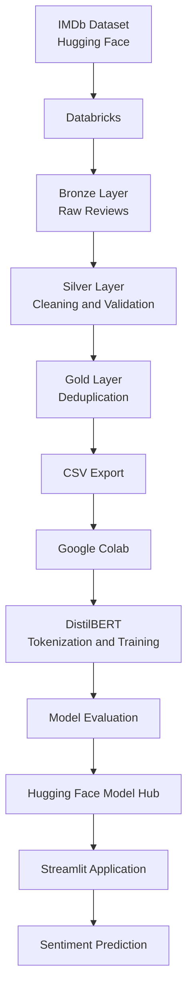
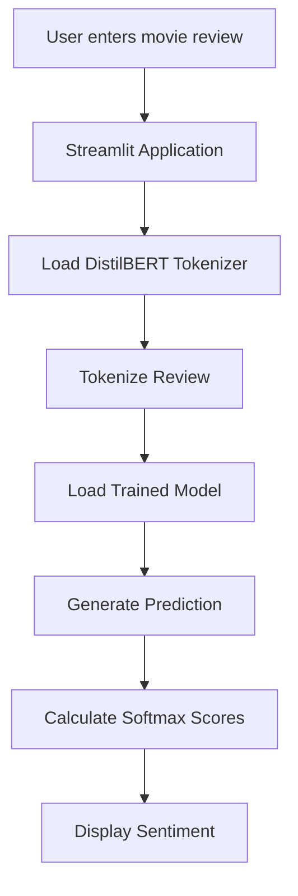

# IMDb Sentiment Analysis using DistilBERT

An end-to-end Natural Language Processing (NLP) project that classifies IMDb movie reviews as **Positive** or **Negative** using a fine-tuned DistilBERT Transformer model.

The project demonstrates a complete machine learning workflow — from data ingestion and preparation using **Databricks**, to model training using **Google Colab**, model hosting on **Hugging Face**, and deployment through **Streamlit Community Cloud**.

app link: https://imdbsentimentanalyzerusingbert-dej6onbmwsg2yc8ghiqmjy.streamlit.app/
---

## Project Overview

Understanding customer opinions is important for businesses in the entertainment industry. Movie reviews contain valuable information about audience satisfaction, preferences, and experiences.

Manually analyzing thousands of reviews is time-consuming. This project uses Natural Language Processing and Transformer-based deep learning to automate sentiment classification.

**Objective:** Build and deploy a sentiment analysis application that predicts whether a movie review expresses positive or negative sentiment.

### Key Results

| Metric | Result |
|---|---:|
| Training Records | 24,877 |
| Testing Records | 25,000 |
| Model | DistilBERT |
| Maximum Token Length | 256 |
| Training Epochs | 2 |
| Test Accuracy | **91.69%** |
| Precision (Positive) | 90.72% |
| Recall (Positive) | 92.87% |
| F1-score (Positive) | 91.79% |

---

## Project Architecture



### Technology Stack

| Category | Technologies |
|---|---|
| Programming Language | Python |
| Data Engineering | Apache Spark, Databricks |
| Data Processing | PySpark, Pandas |
| Dataset | Hugging Face IMDb |
| Deep Learning | PyTorch |
| NLP / Transformers | Hugging Face Transformers |
| Model | DistilBERT |
| Model Hosting | Hugging Face Model Hub |
| Application | Streamlit |
| Deployment | Streamlit Community Cloud |
| Version Control | Git, GitHub |
| Training Environment | Google Colab Free GPU |

---

## Dataset

**Source:** [Stanford IMDb Dataset on Hugging Face](https://huggingface.co/datasets/stanfordnlp/imdb)

The IMDb dataset contains movie reviews labelled according to their sentiment.

### Dataset Structure

| Split | Original Records |
|---|---:|
| Training | 25,000 |
| Testing | 25,000 |
| Unsupervised | Not used |

### Label Mapping

| Label | Sentiment |
|---|---|
| 0 | Negative |
| 1 | Positive |

The original labelled training and testing datasets are balanced, with 12,500 reviews in each sentiment class.

---

## 1. Exploratory Data Analysis (EDA)

Before building the model, exploratory data analysis was performed to understand the dataset's structure, quality, and text characteristics.

### Important Findings

- Analysed review length and word count distributions.
- Examined positive and negative sentiment distribution.
- Identified HTML line breaks in review text.
- Checked duplicate reviews across training and testing splits.
- Investigated token-length distribution.
- Evaluated the impact of different maximum token lengths.

### Token Length Analysis

| Statistic | Token Count |
|---|---:|
| Mean | 313.87 |
| Median | 233 |
| 75th Percentile | 382 |
| 95th Percentile | 806 |
| Maximum | 3,127 |

Approximately 44.25% of reviews exceeded 256 tokens, while 14.8% exceeded 512 tokens.

A maximum sequence length of 256 was selected as a practical balance between computational efficiency and retaining review context.

### Data Leakage Investigation

A total of 123 exact review-text overlaps were identified between the original training and testing datasets.

All 123 overlapping records had matching labels.

These overlapping reviews were removed from the training dataset while retaining the original test dataset.

---

## 2. Databricks Medallion Architecture

The data engineering pipeline was implemented using Databricks and Apache Spark.

A Medallion Architecture was used to organize the dataset into Bronze, Silver, and Gold layers.

### Bronze Layer — Raw Data

Purpose: Store the original ingested datasets.

Tables:

- `imdb_sentiment.bronze.train_reviews`
- `imdb_sentiment.bronze.test_reviews`

Operations:

- Loaded the original IMDb training and testing datasets.
- Preserved the raw review text and labels.
- Added ingestion timestamps.

Record counts:

| Table | Records |
|---|---:|
| Train Reviews | 25,000 |
| Test Reviews | 25,000 |

### Silver Layer — Data Cleaning

Purpose: Improve data quality and prepare review text.

Tables:

- `imdb_sentiment.silver.train_reviews`
- `imdb_sentiment.silver.test_reviews`

Operations:

- Replaced HTML line breaks such as `<br />` with spaces.
- Trimmed unnecessary whitespace.
- Created cleaned text using `clean_text`.
- Created `text_length`.
- Validated null values.
- Checked empty reviews.
- Checked invalid labels.
- Verified remaining HTML line breaks.

All the listed validation checks returned zero invalid records.

### Gold Layer — Analytics-Ready Dataset

Purpose: Produce clean, deduplicated datasets for model training and evaluation.

Tables:

- `imdb_sentiment.gold.train_reviews`
- `imdb_sentiment.gold.test_reviews`

Operations:

- Compared unique cleaned review texts across train and test.
- Removed overlapping reviews from the training dataset using a left anti join.
- Preserved the test dataset for final evaluation.

Final dataset:

| Dataset | Records |
|---|---:|
| Gold Training Dataset | 24,877 |
| Gold Testing Dataset | 25,000 |
| Total | 49,877 |

The final training and testing datasets contained no shared unique review texts.

---

## 3. Data Export and Preparation

Databricks Free Edition was used for data engineering.

Since the DBFS root was unavailable, a Unity Catalog Volume was used for model-training exports.

The Gold datasets were exported as CSV files and transferred to Google Colab.

Files used:

- `train_v2.csv`
- `test_v2.csv`

Final Pandas dataset shapes:

| Dataset | Shape |
|---|---|
| Training | 24,877 × 3 |
| Testing | 25,000 × 3 |

CSV export was selected after encountering Arrow parsing issues during the Parquet handoff.

---

## 4. Model Development — DistilBERT

The sentiment classification model was developed using Hugging Face Transformers and PyTorch.

### Pretrained Model

[DistilBERT Base Uncased](https://huggingface.co/distilbert/distilbert-base-uncased)

DistilBERT is a smaller, faster Transformer model derived from BERT through knowledge distillation.

It provides contextual text representations while requiring fewer computational resources than the original BERT model.

### Model Configuration

| Parameter | Value |
|---|---|
| Model | DistilBERT |
| Architecture | Transformer Encoder |
| Hidden Size | 768 |
| Transformer Layers | 6 |
| Attention Heads | 12 |
| Parameters | 66,955,010 |
| Vocabulary Size | 30,522 |
| Number of Classes | 2 |
| Maximum Sequence Length | 256 |

### Text Preprocessing

The tokenizer converts raw review text into numerical token IDs that the Transformer can process.

The preprocessing workflow included:

1. Tokenization using the DistilBERT tokenizer.
2. Truncation of sequences exceeding 256 tokens.
3. Dynamic padding using `DataCollatorWithPadding`.
4. Generation of attention masks.
5. Conversion into PyTorch tensors.

### Training Configuration

| Parameter | Value |
|---|---|
| Training Environment | Google Colab |
| GPU | NVIDIA Tesla T4 |
| Framework | PyTorch |
| Epochs | 2 |
| Batch Size | 8 |
| Gradient Accumulation | 2 |
| Effective Batch Size | 16 |
| Learning Rate | 2e-5 |
| Optimizer | AdamW |
| Weight Decay | 0.01 |
| Scheduler | Linear Learning Rate Scheduler |
| Warmup Ratio | 10% |
| Mixed Precision | FP16 |

### Training Results

| Epoch | Training Loss |
|---|---:|
| Epoch 1 | 0.3014 |
| Epoch 2 | 0.1534 |

Training loss decreased by approximately 49.1% between the first and second epochs.

The final model was saved locally and prepared for evaluation and deployment.

---

## 5. Model Evaluation

The trained model was evaluated against the 25,000-record Gold testing dataset.

### Classification Metrics

| Metric | Score |
|---|---:|
| Accuracy | **91.69%** |
| Positive Precision | 90.72% |
| Positive Recall | 92.87% |
| Positive F1-score | 91.79% |
| Negative Precision | 93% |
| Negative Recall | 91% |
| Negative F1-score | 92% |

### Confusion Matrix

| Actual / Predicted | Negative | Positive |
|---|---:|---:|
| Negative | 11,313 | 1,187 |
| Positive | 891 | 11,609 |

### Evaluation Summary

- Correct Predictions: 22,922
- Incorrect Predictions: 2,078
- Total Test Records: 25,000

The model achieved 91.69% accuracy on the held-out test dataset.

Positive sentiment recall was higher than negative sentiment recall, indicating that the model identified a slightly larger proportion of actual positive reviews.

### Error Analysis

A small sample of misclassified reviews was manually inspected.

Some observed patterns included:

- Mixed positive and negative opinions.
- Sarcasm and irony.
- Context-dependent expressions.
- Multiple opinions within the same review.
- Ambiguous sentiment.

These observations are qualitative examples, not a statistical explanation of all model errors.

---

## 6. Model Hosting — Hugging Face

The trained model and tokenizer were uploaded to Hugging Face Model Hub.

**Model Repository:**

[SHAILESHGOKU/imdb-distilbert-sentiment](https://huggingface.co/SHAILESHGOKU/imdb-distilbert-sentiment)

The repository contains the trained model weights and configuration required for inference.

Important model files:

- `config.json`
- `model.safetensors`
- `tokenizer.json`
- `tokenizer_config.json`

The hosted model is loaded by the Streamlit application at runtime.

---

## 7. Application Development — Streamlit

A web application was developed using Streamlit to make the trained model accessible through a simple user interface.

### Application Features

- Text input for movie reviews.
- Positive or Negative sentiment prediction.
- Prediction confidence display.
- Simple and interactive interface.
- Model loading from Hugging Face.

### Application Workflow



### Deployment

The application was deployed using Streamlit Community Cloud.

The application uses the model hosted on Hugging Face rather than storing the large model weights inside the GitHub repository.

**Live Application:** Add your Streamlit Community Cloud URL here.

---

## 8. Project Folder Structure

Recommended GitHub repository structure:

```text
imdb-distilbert-sentiment/
│
├── app.py
│
├── requirements.txt
│
├── README.md
│
├── .gitignore
│
└── assets/
    ├── project_architecture.png
    ├── confusion_matrix.png
    └── streamlit_app.png
```

The trained model weights are hosted separately on Hugging Face.

---

## 9. Installation and Local Execution

### Step 1: Clone the Repository

```bash
git clone <YOUR_GITHUB_REPOSITORY_URL>
```

### Step 2: Navigate to the Project

```bash
cd imdb-distilbert-sentiment
```

### Step 3: Create a Virtual Environment

```bash
python -m venv venv
```

Activate it on Windows:

```bash
venv\Scripts\activate
```

Activate it on Linux or macOS:

```bash
source venv/bin/activate
```

### Step 4: Install Dependencies

```bash
pip install -r requirements.txt
```

### Step 5: Run the Streamlit Application

```bash
streamlit run app.py
```

The application will be available at:

```text
http://localhost:8501
```

---

## 10. Requirements

The project uses the following major Python libraries:

- `streamlit`
- `torch`
- `transformers`
- `huggingface_hub`
- `numpy`

The exact dependency versions should be maintained in `requirements.txt` based on the working deployment environment.

---

## 11. Engineering Challenges and Solutions

| Challenge | Solution |
|---|---|
| Duplicate reviews across train and test | Removed overlapping records from training |
| HTML tags in review text | Replaced HTML line breaks and trimmed text |
| Long review sequences | Selected a 256-token maximum length |
| Databricks DBFS root unavailable | Used Unity Catalog Volumes |
| Arrow parsing issues during export | Switched to CSV export |
| GPU memory constraints | Used batch size 8 and gradient accumulation |
| Model hosting | Uploaded trained weights to Hugging Face |
| Large model files in GitHub | Kept model weights outside GitHub |
| CPU/GPU device mismatch during inference | Moved model and input tensors to the same device |

---

## 12. Key Learnings

This project provided practical experience across several areas of modern AI engineering.

### Data Engineering

- Apache Spark and PySpark.
- Databricks Unity Catalog.
- Medallion Architecture.
- Data quality validation.
- Dataset deduplication.
- CSV data export.

### Machine Learning and Deep Learning

- NLP preprocessing.
- Transformer architecture.
- DistilBERT fine-tuning.
- PyTorch training workflows.
- GPU-based training.
- Model evaluation.
- Confusion matrix and classification metrics.

### AI Deployment

- Hugging Face Model Hub.
- Model serialization and loading.
- Streamlit application development.
- GitHub version control.
- Cloud application deployment.

---

## 13. Limitations and Future Improvements

Although the model achieved 91.69% test accuracy, there are several opportunities for improvement.

### Model Improvements

- Experiment with different maximum sequence lengths.
- Compare DistilBERT with BERT and other lightweight Transformer models.
- Perform hyperparameter optimization.
- Introduce a validation dataset for model selection.
- Evaluate probability calibration.
- Investigate misclassified reviews in greater depth.

### Application Improvements

- Add batch review prediction.
- Display sentiment distribution for multiple reviews.
- Add downloadable prediction reports.
- Improve inference speed.
- Add prediction history and analytics.

### MLOps Improvements

- Introduce experiment tracking.
- Version datasets and models.
- Automate model evaluation.
- Implement continuous integration and deployment.
- Monitor prediction quality and application performance.

---

## 14. Business Applications

The same sentiment analysis approach can be extended to real-world business problems.

Potential applications include:

- Movie and entertainment review analysis.
- E-commerce product review analysis.
- Customer feedback classification.
- Brand sentiment monitoring.
- Customer experience analytics.
- Social media opinion analysis.

Businesses can use sentiment classification to understand customer feedback at scale and identify areas requiring attention.

---

## 15. Author

**Shailesh Shripathi**

Interested in solving real business problems using AI, Machine Learning, and Data Engineering.

- Hugging Face: [SHAILESHGOKU](https://huggingface.co/SHAILESHGOKU)

---

## Acknowledgements

- [Stanford IMDb Dataset](https://huggingface.co/datasets/stanfordnlp/imdb)
- [Hugging Face Transformers](https://huggingface.co/docs/transformers)
- [DistilBERT](https://huggingface.co/distilbert/distilbert-base-uncased)
- [Databricks](https://www.databricks.com/)
- [Google Colab](https://colab.research.google.com/)
- [Streamlit](https://streamlit.io/)

---

## License

This project is intended for educational and research purposes. Add an appropriate repository license before redistributing the project.

---

**Built as an end-to-end AI engineering project — from raw data to a deployed sentiment analysis application.**
